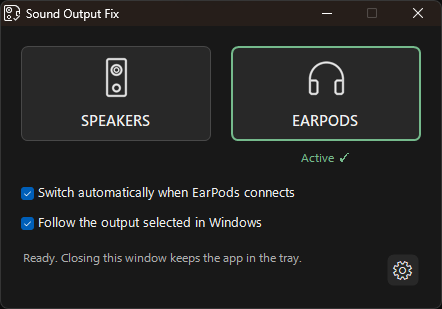
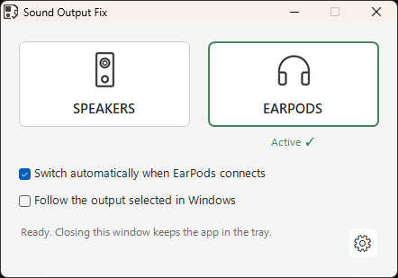

# Sound Output Fix

I created Sound Output Fix to work around an issue where Spotify keeps playing through the previous audio output after switching devices in Windows.

**Windows 10/11 · 64-bit · Version 1.2.0**

[Download v1.2.0](https://github.com/Saiprien/sound-output-fix/releases/tag/v1.2.0) · [Report an issue](https://github.com/Saiprien/sound-output-fix/issues)

### Default appearance

**Dark**

**Light**

The app includes default speaker and headphone icons. To use your own images, open **Settings → Devices → Choose…**, select a PNG or JPG file, then click **Apply**. **Reset** restores the default icon. Custom images are saved locally and are not included in the default app package.

## Features

- Switch between two configurable audio outputs.
- Follow output changes made in Windows or switch automatically when headphones connect.
- See the active device in the window and tray menu.
- Customize button names and images.
- Choose Light, Dark or System theme, and English, Romanian, Russian or Simplified Chinese.
- Optionally start with Windows.

## Getting started

1. Extract the portable ZIP into a folder you intend to keep.
2. Open **SoundOutputFix.exe**. Keep all included files in the same folder.
3. In **Settings → Devices**, select your two audio outputs and click **Apply**.
4. Click a device button to switch outputs.

If Spotify is running, the app restarts it to apply the change. Once the Spotify process is detected, the app waits 4 seconds before restoring the other output. Total switching time varies by computer. Enable **Automatically resume playback after switching devices** in **Settings → General** to use automatic resumption (off by default). With this option enabled, the app attempts to resume Spotify only if its Windows media session reported that it was playing before the switch. If Spotify was paused, closed, or its state could not be read, no Play command is sent. Press **Play** manually if automatic resumption is unavailable. If Spotify is closed, it stays closed.

**Windows SmartScreen:** The executable is not digitally signed, so Windows may display an unrecognized-app warning. If you trust the download from the [official releases page](https://github.com/Saiprien/sound-output-fix/releases), select **More info → Run anyway**. You do not need to disable Microsoft Defender.

When updating, exit the running version from its tray menu before opening the new version.

During a switch, **Switching…** means Spotify is restarting. **Finishing…** means Spotify has opened and the app is completing restoration of the other output. The yellow outline grows from 1 px during Switching to 2 px during Finishing. **Active ✓** marks completion with a green outline. Clicking the output already active does not restart Spotify.

## Settings and tray

**General** contains language, theme and Windows startup. **Devices** contains the names, audio outputs and images for both buttons.

Closing the window leaves the app running in the tray. Double-click the tray icon to reopen it, or choose **Exit** to close it completely.

## Requirements

Windows 10/11 x64, Windows PowerShell 5.1 and .NET Framework 4.x. Extract the app into a writable folder; no installer is required.

## Notes

During the Spotify restart, the other configured output is temporarily disabled and restored afterwards. Other apps using that output may be affected.

If your headphones appear only as an input device, check whether their playback output is disabled in Windows. For more help, see [Troubleshooting](docs/TROUBLESHOOTING.md).

## Project information

I developed Sound Output Fix and make it available for noncommercial use under the [PolyForm Noncommercial License 1.0.0](LICENSE). Commercial use that is not permitted by the license requires a separate agreement with me. See [Licensing](docs/LICENSING.md).

For commercial licensing inquiries, contact [ciprian.balaban40@yahoo.com](mailto:ciprian.balaban40@yahoo.com).

Required Notice: Copyright (c) 2026 Saiprien

Sound Output Fix is independent and is not affiliated with Spotify.

[Version history](CHANGELOG.md) · [Third-party notices](THIRD_PARTY_NOTICES.md) · [Licensing](docs/LICENSING.md) · [Technical documentation](docs/ARCHITECTURE.md)

### Startup after updating

Open the current version, then turn **Start with Windows** off and on in Settings to replace any shortcut pointing to an older folder. When Windows starts, the app runs in the system tray without opening a window. Launching it manually opens the window.

### Startup window preference

In Settings → General, enable **Start with Windows**, then choose **Start in tray at Windows sign-in** to keep the window hidden at login. Disable this second option to show the window at login. Manual launches still open the window. After upgrading, toggle Start with Windows off and on once to update the startup shortcut. Settings displays the running version beside the creator credit.

## Reported issues

A brief stutter during output switching under heavy gaming load and split audio after startup with EarPods connected are under investigation. See [Reported issues](docs/REPORTED_ISSUES.md).
